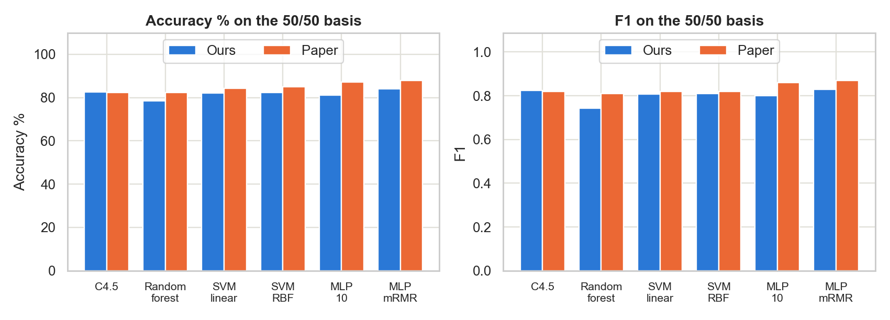
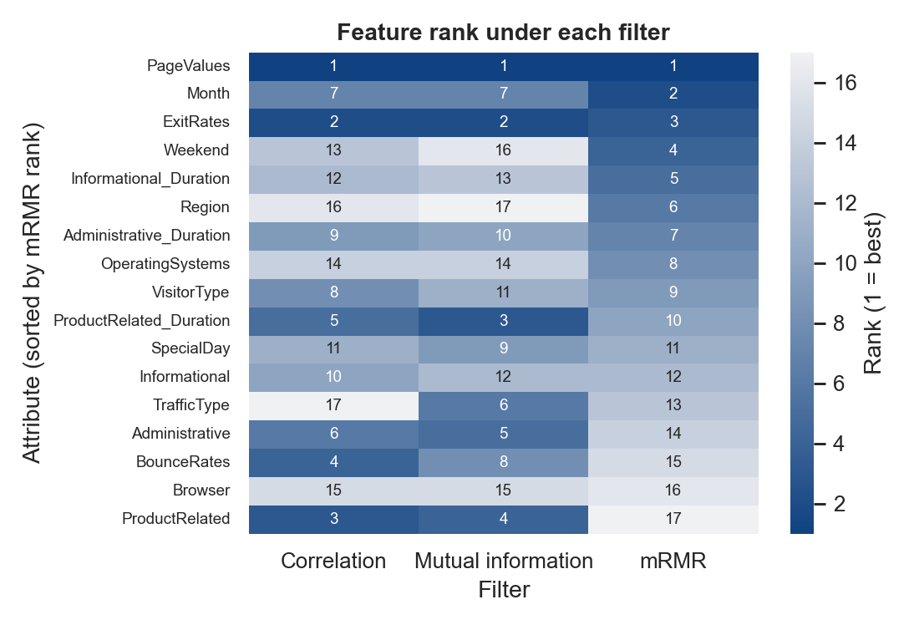
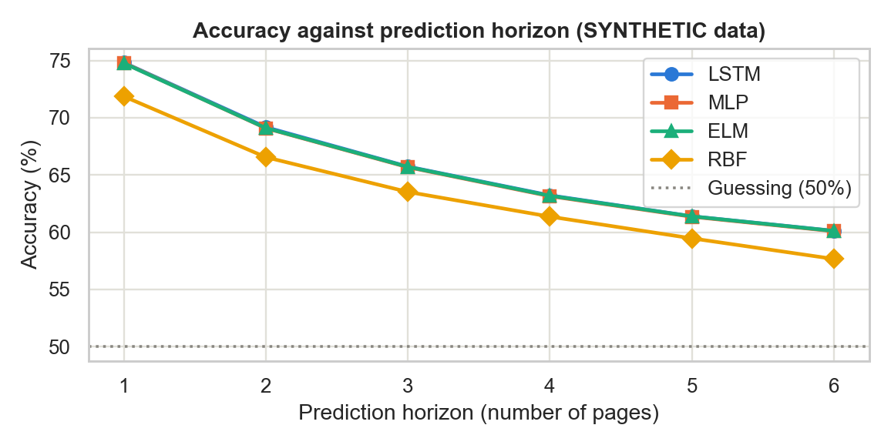
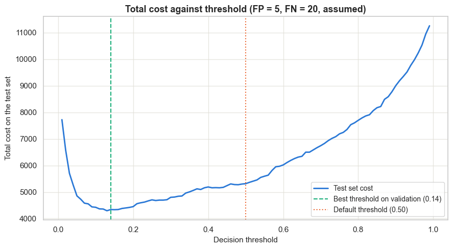

# Replicating "Real-time prediction of online shoppers' purchasing intention"

Team: Aashit Kumar Singh (24322001) and Dhruv Singh Bisht (24321011)

Course: Analytics for Business and Society [HST-105]

## 1 Introduction
We replicated and extended the paper by Sakar, Polat, Katircioglu and Kastro (2019). The paper builds a system that watches an online shopper and decides whether to show an offer. We wanted to see if we could get the same results by following the paper's description. Our main result is mixed. Many parts came out close to the paper, but we did not find that its neural network clearly wins.

## 2 The paper in short
The paper has two modules. Module 1 predicts whether a session will end in a purchase. Module 2 predicts whether the visitor is about to leave. The system shows an offer only to visitors who look likely to leave and also likely to buy.

For module 1, the paper reports that a multilayer perceptron (MLP), a simple neural network, wins. F1 is one score that combines how many buyers the model finds with how many of its "buyer" guesses are right. With 10 hidden neurons the paper reports accuracy 87.24% and F1 0.86. With the top 6 attributes chosen by mRMR, a method that picks useful attributes that do not repeat each other, it reports 87.94% and F1 0.87. For module 2, it reports that an LSTM (long short-term memory network), which reads a sequence step by step, reaches 74.3% accuracy when predicting one page ahead.

## 3 Data
For module 1 we used the public dataset of 12,330 sessions with 17 attributes (notebook 01). Only 15.5% of sessions end in a purchase, and nothing is missing. The numbers match the paper's Table 1 closely. We found two differences. Our file has 10 months and not 12, because January and April are missing. One-hot coding, which turns each category into its own 0 or 1 column, gives us 74 input columns and not the paper's 70 (notebook 02).

The paper's data for module 2 is private. Our professor approved synthetic data, so we generated it ourselves (notebook 07): 3,500 visitors, 9,800 sessions and 184,409 page views, against the paper's 3,500, 9,800 and 185,000. This data is SYNTHETIC, so only the method of module 2 is replicated.

## 4 Module 1: predicting a purchase
### Method
In each repeat we split the data 70/30 with a new random split, keeping the same share of buyers in both parts. We used the same splits for every model. Our baselines are a decision tree (the paper uses C4.5), a random forest, which is a vote among many trees, and support vector machines (SVM), which look for the best boundary between the classes, either straight (linear) or curved (RBF). We report four measures. Accuracy is the share of all sessions labelled correctly. TPR (true positive rate) is the share of real buyers the model finds. TNR (true negative rate) is the share of non-buyers it labels correctly. F1 is the combined score described above. To compare two models we used a paired t-test, which compares them one repeat at a time on the same split. When we call a difference significant, we mean it is unlikely to be just chance.

### Results without oversampling
Table 1 and Table 2 show that accuracy looks high, but the models miss about half of the buyers or more. Always answering "no purchase" already gives 84.5%, so accuracy alone misleads. Most of our values are close to the paper. Our largest gap is RBF SVM, which is higher than the paper (89.42% against 86.14%).

Table 1. Decision tree, random forest and SVM on imbalanced data (notebook 03)

| Model | Accuracy % ours | Accuracy % paper | TPR ours | TPR paper | TNR ours | TNR paper | F1 ours | F1 paper |
|---|---|---|---|---|---|---|---|---|
| C4.5 | 89.91 | 88.92 | **0.55** | **0.57** | 0.96 | 0.96 | **0.63** | 0.57 |
| Random forest | **89.95** | **89.51** | 0.50 | **0.57** | 0.97 | 0.96 | 0.61 | **0.58** |
| SVM linear | 88.54 | 88.25 | 0.39 | 0.42 | **0.98** | **0.97** | 0.51 | 0.52 |
| SVM RBF | 89.42 | 86.14 | 0.48 | 0.46 | 0.97 | 0.92 | 0.59 | 0.53 |

Under the table: 10 repeats. Bold marks the best value in each column. C4.5 is approximated by an entropy tree.

Table 2. MLP on imbalanced data, all three hidden sizes (notebook 04)

| Model | Accuracy % ours | Accuracy % paper | TPR ours | TPR paper | TNR ours | TNR paper | F1 ours | F1 paper |
|---|---|---|---|---|---|---|---|---|
| MLP 10 | **88.53** | 87.45 | **0.58** | 0.53 | **0.94** | 0.94 | **0.61** | 0.56 |
| MLP 20 | 87.82 | **87.92** | 0.57 | **0.56** | 0.93 | **0.96** | 0.59 | **0.58** |
| MLP 40 | 87.62 | 87.02 | 0.56 | 0.54 | 0.93 | 0.93 | 0.58 | 0.56 |

Under the table: 10 repeats. Bold marks the best value in each column.

In our results, checked from results/mlp.csv, 10 hidden neurons is the best size on all four measures. In the paper, 20 is best on accuracy and F1. Our MLP is close to the paper here.

### Results with oversampling
Oversampling means copying rows of the smaller class until the two classes have the same size. We did this only on the train part, so our test set keeps its natural mix of 15.5% buyers.

The paper's oversampled figures appear to fit a test set with 50% buyers, even though its text says only the train part was oversampled. This is our reading of the paper, and the paper does not say it directly. For example, its random forest has TPR 0.74 and TNR 0.90, which would give about 87.5% on a test set with 15.5% buyers, but the paper reports 82.29%, the plain average of TPR and TNR. So Table 3 shows our accuracy and F1 both on the natural test set and converted to a 50/50 test set. We compare the 50/50 columns with the paper.

Table 3. All models on oversampled data, with the 50/50 conversion (notebooks 03, 04 and 06)

| Model | Acc. % natural | Acc. % 50/50 | Acc. % paper | TPR ours | TPR paper | TNR ours | TNR paper | F1 natural | F1 50/50 | F1 paper |
|---|---|---|---|---|---|---|---|---|---|---|
| C4.5 | 83.10 | 82.57 | 82.34 | **0.82** | 0.79 | 0.83 | 0.85 | 0.60 | 0.82 | 0.82 |
| Random forest | **89.89** | 78.52 | 82.29 | 0.62 | 0.74 | **0.95** | 0.90 | 0.66 | 0.74 | 0.81 |
| SVM linear | 87.53 | 82.19 | 84.26 | 0.74 | 0.75 | 0.90 | 0.93 | 0.65 | 0.81 | 0.82 |
| SVM RBF | 87.63 | 82.37 | 84.88 | 0.75 | 0.75 | 0.90 | **0.94** | 0.65 | 0.81 | 0.82 |
| MLP 10 | 84.91 | 81.11 | 87.24 | 0.76 | **0.84** | 0.87 | 0.92 | 0.61 | 0.80 | 0.86 |
| MLP 20 | 86.15 | 79.65 | 83.84 | 0.70 | **0.84** | 0.89 | 0.83 | 0.61 | 0.78 | 0.83 |
| MLP 40 | 86.62 | 78.57 | 82.15 | 0.67 | 0.82 | 0.90 | 0.83 | 0.61 | 0.76 | 0.82 |
| MLP mRMR | 88.15 | **83.92** | **87.94** | 0.78 | **0.84** | 0.90 | 0.92 | **0.67** | **0.83** | **0.87** |

Under the table: 10 repeats. Bold marks the best value in each column. Acc. means accuracy. "Natural" keeps 15.5% buyers in the test set. "50/50" is calculated from our TPR and TNR. MLP mRMR uses the top 2 attributes in our work and the top 6 in the paper.

Oversampling raises TPR for every model. On the 50/50 basis, C4.5 is very close to the paper (82.57% against 82.34%). The SVMs are about 2 to 3 points lower. Random forest is about 4 points lower, with TPR 0.62 against 0.74.

The main difference is the MLP. The paper finds it clearly best. On the 50/50 basis, our MLP with 10 neurons (81.11%, F1 0.80) is below C4.5 (82.57%, F1 0.82) and RBF SVM (82.37%, F1 0.81), and these differences are unlikely to be just chance. As in the paper, 10 neurons is better than 20 or 40 on this basis.

### Feature selection
We ranked the 17 attributes with three filters (notebook 05). Correlation measures how closely an attribute moves with the purchase. Mutual information measures how much knowing the attribute tells us about the purchase. mRMR (minimum redundancy, maximum relevance) prefers attributes that are useful but do not repeat attributes already chosen. Our mRMR ranking almost exactly matches the paper's, and only ranks 7 and 8 swap. PageValues comes first in all three rankings, as in the paper. BounceRates falls to rank 15 under mRMR because it repeats ExitRates. Figure 2 shows the ranks.

We then fed the top k attributes, for k from 1 to 10, to the MLP with 10 neurons (notebook 06). Table 4 shows each filter at its best k.

Table 4. MLP on the top k attributes at each filter's best k (notebook 06)

| Filter | k ours | k paper | Acc. % 50/50 | Acc. % paper | TPR ours | TPR paper | TNR ours | TNR paper | F1 50/50 | F1 paper |
|---|---|---|---|---|---|---|---|---|---|---|
| Correlation | 2 | 9 | 84.15 | 84.32 | 0.79 | **0.84** | 0.89 | 0.85 | 0.83 | 0.84 |
| Mutual information | 4 | 10 | **84.26** | 84.11 | **0.81** | **0.84** | 0.87 | 0.85 | **0.84** | 0.84 |
| mRMR | 2 | 6 | 83.92 | **87.94** | 0.78 | **0.84** | **0.90** | **0.92** | 0.83 | **0.87** |

Under the table: 10 repeats. Bold marks the best value in each column, except k. Accuracy and F1 are on the 50/50 basis.

Correlation and mutual information are very close to the paper. mRMR is about 4 points lower. Unlike the paper, mRMR does not win: it is below the other two filters on accuracy and F1, and these differences are unlikely to be just chance. Correlation and mutual information show no significant difference on accuracy. We also needed far fewer attributes than the paper. PageValues alone reaches 83.83%, and the MLP on PageValues and Month reaches 83.92%, the highest accuracy in Table 3 on the 50/50 basis. We are not sure why so few attributes work this well.

## 5 Module 2: predicting that a visitor will leave
The input is the last 3 page views, each described by its page type and the time spent on it. The prediction horizon, h, is how many page views ahead we look: the label is 1 if the session ends within the next h page views. We compared an LSTM with 30 units against three simpler networks that see the same 3 pages flattened into one input: an MLP, an Extreme Learning Machine (ELM), and an RBF network. All test sets are balanced, so guessing gets 50%.

Table 5. Accuracy % by prediction horizon on SYNTHETIC data (notebook 08)

| Model | h=1 | h=2 | h=3 | h=4 | h=5 | h=6 |
|---|---|---|---|---|---|---|
| LSTM | **74.8** | **69.2** | **65.7** | **63.2** | **61.4** | **60.1** |
| MLP | **74.8** | 69.1 | **65.7** | 63.1 | 61.3 | **60.1** |
| ELM | **74.8** | 69.1 | **65.7** | **63.2** | **61.4** | **60.1** |
| RBF | 71.9 | 66.6 | 63.5 | 61.4 | 59.5 | 57.7 |

Under the table: 5 seeds. Bold marks the best value in each column. The paper's accuracy is not comparable (synthetic data), so we do not show it here.

Accuracy falls as the horizon grows, the same pattern the paper shows. The LSTM beats RBF at every horizon. It is at most 0.09 points ahead of MLP and ELM, which has no practical meaning. This was expected, because our generator depends only on the current page, so earlier pages add nothing for the LSTM to use. We chose the generator's numbers ourselves, and we strengthened them after a first version gave too weak a signal. So our accuracy says nothing about how the paper's LSTM performs on real data.

We also varied the score threshold above which a visitor is flagged. Raising it lowers TPR and raises precision, the share of flagged visitors who really leave. At horizon 1, going from 0.60 to 0.90 lowers TPR from 0.61 to 0.02 and raises precision from 0.84 to 0.92. The paper's Figure 2 labels its curves "true positive rate", and they appear to rise with the threshold. A true TPR should not rise that way, so we read those curves as probably showing precision. This is our reading, and the paper does not say so.

## 6 Our extensions
In notebook 10 we tried two more models, compared ways of handling the uneven classes, and looked at business cost. Gradient boosting builds many small trees, each fixing the errors of the ones before it. SMOTE creates new purchase rows between similar existing rows. Class weight keeps the data but counts purchase rows more during training.

Table 6. Extra models and imbalance treatments, on the natural test set (notebook 10)

| Model or treatment | Accuracy | TPR | TNR | F1 |
|---|---|---|---|---|
| Gradient boosting, random oversampling | 0.875 | 0.778 | 0.893 | 0.659 |
| Logistic regression, random oversampling | 0.847 | 0.752 | 0.864 | 0.603 |
| Gradient boosting, SMOTE | 0.898 | 0.664 | 0.940 | **0.667** |
| Gradient boosting, class weight | 0.876 | **0.783** | 0.893 | 0.661 |
| Gradient boosting, no treatment | **0.901** | 0.589 | **0.958** | 0.648 |

Under the table: 10 repeats. Bold marks the best value in each column. The paper did not run these experiments.

Gradient boosting has the highest F1 of the two extra models, and it is not significantly above random forest (0.655). SMOTE gives a slightly higher F1 than random oversampling but finds fewer buyers.

We also chose a score threshold based on cost, assuming a wasted offer costs 5 and a missed buyer costs 20. These costs are our assumptions. On one split, a threshold of 0.14 chosen on validation data cuts the test cost by 18.3% against the default 0.5 (from 5,315 to 4,340). TPR rises from 0.601 to 0.811, while accuracy falls from 0.898 to 0.853. So the cheapest threshold is not the one with the best accuracy.

## 7 Differences from the paper and limitations
- C4.5 is approximated by an entropy decision tree with pruning, because our library builds CART-style trees.
- We train with RPROP, a method that gives each weight its own step size. PyTorch's version has no weight backtracking, which undoes a bad step, and the paper used it.
- We stop MLP training at 300 epochs, and the paper sets no limit. An epoch is one pass through the training data. All 60 runs in notebook 04 hit this limit.
- The clickstream data is SYNTHETIC, and it depends only on the current page.
- We used 10 repeats (5 seeds for the LSTM), and the paper uses 100 for module 1.
- Our oversampled test set keeps the natural class mix, while the paper's figures appear to fit a 50/50 test set.
- We fit standardization, which rescales each feature to mean 0 and standard deviation 1, on the train part only, and the paper standardizes before splitting.
- We have 74 input columns and 10 months, against the paper's 70 and 12.
- We show both TPR and precision for the paper's Figure 2 (right).
- The paper does not state the LSTM's training details, so Adam, learning rate 0.001, 20 epochs and undersampled balanced training data are our choices.

Our work also has limits. Ten repeats give less stable significance results than 100. The feature rankings and SVM settings come from one split that overlaps later test sets, and we choose the best k from test results, so these results may be slightly optimistic. Correlation treats category codes as numbers, which means little for attributes such as Browser. Modules 1 and 2 use unrelated data, so we can only illustrate the combined system. The cost analysis uses assumed costs on one split, and it ignores discounts given to visitors who would have bought anyway.

## 8 Conclusion
Much of the paper replicated well. Accuracy alone misleads on this data, oversampling raises TPR, PageValues is the strongest attribute, and our mRMR ranking almost matches the paper's.

The paper's main claim did not replicate. Our full MLP ranks below C4.5 and RBF SVM, mRMR does not beat the other filters, and our best results use only 2 to 4 attributes.

We must be careful about what this means. All 60 MLP runs in notebook 04 stopped at the 300-epoch limit, before reaching the paper's stopping rule. Notebook 06 uses the same training code and limit, but it did not record this count. So our weak MLP result may be due to our training and not to the method itself. The missing weight backtracking could also play a part. We did not test either explanation.

For a shop, our extension suggests that the decision threshold should follow the real costs of each error, and that a few well-chosen attributes may be enough.
